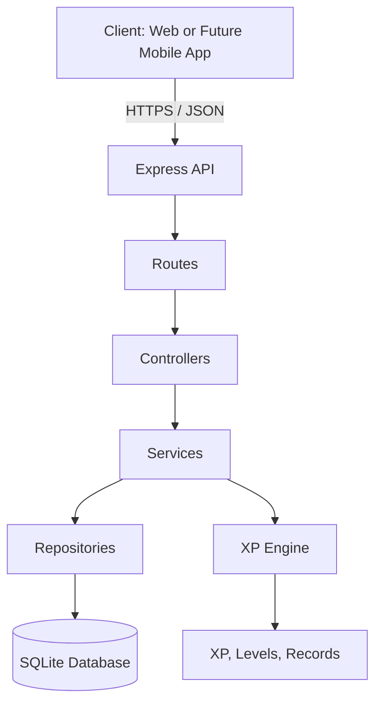

# Ownform

**Level up your real life.**

Ownform is a personal development application that turns real-life actions into experience points (XP) and character progression. Inspired by RPG mechanics, it helps users track their growth, build habits, and visualize their progress across different areas of life.

The long-term vision is to make Ownform a mobile application that becomes part of everyday life, making it easy to record actions and track personal progress anywhere. Development will start with a web-based MVP to establish the core functionality, validate the progression system, and build a solid technical foundation before moving toward a mobile experience.

## Status

**Currently under development.** Phase 0 (setup and design) is complete. Phase 1 (authentication, database connection, and XP engine) is next.

See the [Roadmap](#roadmap) for the planned development phases.

## What is Ownform?

Ownform applies RPG-style progression to real life. Actions such as completing a workout, reading a book, improving personal style, or stepping outside your comfort zone contribute to the progress of a character.

The project is planned around four modules:

- **Gym:** Track workouts, exercises, personal records, and Strength XP.
- **Books:** Turn ideas from books into actions and experiments.
- **Style:** Develop personal style through clothing, outfits, color theory, and weather.
- **Confidence:** Track challenges that involve stepping outside your comfort zone.

The first version (MVP) focuses exclusively on the Gym module. The initial implementation will use web technologies, while the long-term goal is to evolve Ownform into a mobile application.

Ownform is also a portfolio project focused on building a maintainable backend, designing a REST API, working with relational databases, implementing authentication, and testing business logic.

## MVP Features

The following checklist represents the planned scope for version 1.0. Items will be checked as they are implemented and tested.

- [ ] User registration and login with hashed passwords and JWT authentication.
- [ ] Read-only demo mode with sample data.
- [ ] Gym module with an exercise catalog, workout registration, sets, and personal-record detection.
- [ ] XP and level engine with configurable rules and automated tests.
- [ ] Action log that records every XP award and its source.
- [ ] Character screen with statistics, progress bars, and recent activity.
- [ ] Workout history and weekly XP chart.
- [ ] Responsive, mobile-first web interface using HTML, CSS, and JavaScript.
- [ ] Input validation, consistent error handling, and rate limiting.
- [ ] Automated tests and API documentation.
- [ ] Public deployment with a working demo.

## Tech Stack

The project will introduce technologies incrementally. The table below distinguishes what is already in the repository from what is planned.

| Area | Technology | Status |
|---|---|---|
| Runtime | Node.js | Already in the repository |
| Code quality | ESLint | Already in the repository |
| Formatting | Prettier | Already in the repository |
| Backend framework | Express | Planned |
| Database | SQLite with `better-sqlite3` | Planned |
| Input validation | Zod | Planned |
| Password hashing | bcrypt | Planned |
| Authentication | JWT | Planned |
| Testing | `node:test` | Planned |
| Continuous integration | GitHub Actions | Planned |
| Backend language | TypeScript | Planned for a later phase |
| Frontend framework | React | Planned for a later phase |

The initial implementation will use JavaScript and plain HTML, CSS, and JavaScript for the frontend. TypeScript and React will be introduced after the initial MVP.

## Architecture

Ownform will follow a **modular monolith** architecture: one deployable application organized into modules with clear responsibilities. The backend will separate routes, controllers, services, and repositories so that HTTP handling, business logic, and database access remain independent.

The XP engine will be pure domain logic. It will calculate XP, levels, personal records, and applicable limits without depending on Express or the database, making it easier to test and maintain.

SQLite will be the initial database, with PostgreSQL as a possible future option.

### High-level architecture



See [`docs/decisions/`](docs/decisions/) for architecture decision records explaining the main technical choices.

## Repository Structure

The following is the **planned repository structure**. Not every directory or file exists yet.

```text
ownform/
├── README.md
├── backend/
│   ├── package.json
│   ├── src/
│   │   ├── app.js
│   │   ├── server.js
│   │   ├── routes/
│   │   ├── controllers/
│   │   ├── services/
│   │   ├── repositories/
│   │   ├── modules/
│   │   └── domain/
│   │       └── xp/
│   └── test/
├── frontend/
│   ├── index.html
│   ├── css/
│   └── js/
└── docs/
    ├── database-design.md
    └── decisions/
```

Git does not track empty directories, so some planned folders may not appear in the repository until files are added.

## Getting Started

### Prerequisites

- [Node.js](https://nodejs.org/) LTS
- [Git](https://git-scm.com/)

### Installation

Clone the repository:

```bash
git clone <https://github.com/trianajuand/ownform.git>
```

Enter the backend directory:

```bash
cd ownform/backend
```

Install the dependencies:

```bash
npm install
```

Run ESLint:

```bash
npm run lint
```

Check code formatting:

```bash
npm run format:check
```

These commands cover the current setup and code-quality checks. **The application server and API have not been implemented yet**, so there is no server to start at this stage.

## Documentation

Project documentation and technical decisions will be maintained alongside the code.

- [Database Design](docs/002-database-design.md) — Planned database schema and relationships.
- [Architecture Decision Records](docs/decisions/001-architecture.md) — Technical decisions, their reasoning, and their consequences.

## Roadmap

The project will be developed incrementally, keeping the MVP scope focused before introducing additional modules and technologies.

- [x] **Phase 0 — Preparation:** Repository setup, folder structure, ESLint, Prettier, initial README, and database design.
- [ ] **Phase 1 — Core:** Authentication, database connection, and tested XP engine.
- [ ] **Phase 2 — Gym Module:** Exercise catalog, workouts, sets, personal records, XP, and action log.
- [ ] **Phase 3 — Frontend:** Login, character screen, workout registration, results, and history.
- [ ] **Phase 4 — Polish and Deployment:** Demo mode, error handling, documentation, continuous integration, and public deployment.
- [ ] **Phase 5 — Books Module:** Turn reading into actions, experiments, and spaced repetition.
- [ ] **Phase 6 — TypeScript:** Migrate the backend, starting with the XP engine.
- [ ] **Phase 7 — React:** Rebuild the frontend on top of the existing API.
- [ ] **Phase 8 — Style and Confidence:** Add the Style and Confidence modules.
- [ ] **Phase 9 — Extras:** Intelligent progression, balance between life areas, and a potential progressive web app (PWA).

The estimated development time for the initial MVP is 8–11 weeks. Later phases will depend on the project's progress and priorities.

## License

This project is licensed under the MIT License. See [`LICENSE`](LICENSE) for details.
