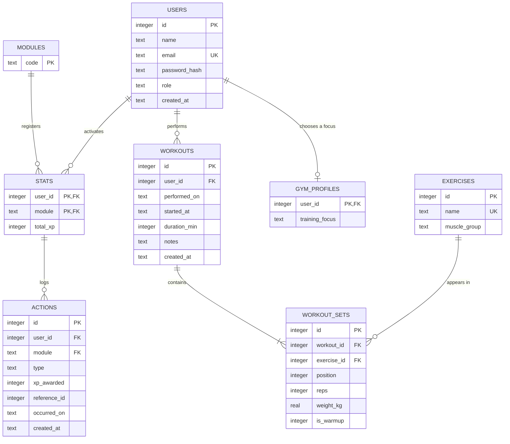

# Ownform: Database Design

**Status:** draft v0.3, written for the project owner's review. The owner has answered the business questions O1 to O9 (section 8) and approved the schema changes of v0.3.
**Changes in v0.2:** added the `modules` registry table (D12) after a review question from the owner, and updated D6, the diagram, the dictionary, the normalization analysis and section 9.1. Added sections 9.4 and 9.5.
**Changes in v0.3:** three additions after the XP rules were decided (`xp-rules.md`): `workouts.started_at` (D13), `workout_sets.is_warmup` (D14) and the `gym_profiles` table (D15). Migration 001 was edited in place because no database had been created from it yet (D10). O1 to O9 are answered (section 8). The references to Appendices A and B, which did not exist, were replaced by a real Appendix A with tested queries. Sections 7 and 9.2 were updated.
**Date:** 2026-10-22
**Scope:** MVP (gym module) plus the seams needed so later modules (Books, Style, Confidence) can be added without redesigning the core.
**Based on:** the project document (sections 5, 7, 9.7 and 10). Where this design differs from section 9.7, the difference is listed in section 6.

How to read this: sections 1 and 2 explain the concepts and principles. Sections 3 to 5 are the design itself. Section 6 lists every decision with its alternatives, and section 8 lists the open questions that need an answer from the owner. The SQL is in `backend/src/db/migrations/001_initial_schema.sql` and was executed and tested (section 9). Appendix A has the example queries.

---

## 1. Concepts used in this document

### 1.1 Why normalize at all

A table that mixes several kinds of facts causes three classic problems (called anomalies). Imagine one flat table for everything:

`workout_log(user_email, workout_date, exercise_name, muscle_group, reps, weight_kg)`

- **Update anomaly:** renaming "Bench press" means changing every row that mentions it. Miss one and the data contradicts itself.
- **Insert anomaly:** you cannot add a new exercise to the catalog until someone logs a workout with it.
- **Delete anomaly:** deleting the only workout that used an exercise also deletes the knowledge that the exercise exists.

Normalization is a set of rules for splitting tables so that **each fact is stored once, in the place it belongs**.

### 1.2 Functional dependencies and keys

- A **functional dependency** `A → B` means: for each value of A there is exactly one value of B. Examples: `exercise_id → name`, `email → id`.
- A **candidate key** is a minimal set of columns that identifies a row uniquely. The one we pick is the **primary key**.
- A **prime attribute** is a column that belongs to some candidate key. A **non-prime** attribute is any other column.

### 1.3 The normal forms

| Form | Rule | Ownform example of a violation |
|---|---|---|
| **1NF** | Every cell holds one atomic value (no lists, no repeating column groups) and rows are identifiable by a key. | Storing sets as `"10x60, 8x65, 6x70"` in one cell, or columns `reps1, reps2, reps3`. The fix is one row per set. |
| **2NF** | 1NF, and no non-prime column depends on only **part** of a candidate key. It only matters when a candidate key is composite. | `workout_sets(workout_id, position, workout_date, ...)`. `workout_date` depends on `workout_id` alone, so it belongs in `workouts`. |
| **3NF** | 2NF, and no non-prime column depends on another non-prime column (no transitive dependency). Formally: for every dependency `X → A`, X is a superkey or A is a prime attribute. | `stats(user_id, module, total_xp, level)`: `level` is determined by `total_xp`, which is not a key. |
| **BCNF** | A slightly stricter 3NF: for every dependency `X → A`, X must be a superkey. | The same examples as above. |

A memorable summary of 2NF and 3NF (W. Kent, 1983): every non-key attribute must depend on **the key, the whole key, and nothing but the key**.

Two precisions that matter later:
- If every candidate key of a table is a single column, 2NF holds automatically once the table is in 1NF.
- Normal forms are about dependencies **inside one table**. A value that can be computed from rows of *other* tables (like a total) is not flagged by 1NF to 3NF, but it is still redundancy and needs a consistency strategy (see D3).

### 1.4 Cardinality and participation

- **Cardinality** says how many rows on one side can relate to one row on the other: **1:1**, **1:N** or **N:M**.
- **Participation** says whether the relationship is mandatory (minimum 1) or optional (minimum 0) for each side.
- The foreign key always lives on the "many" side of a 1:N relationship.
- An **N:M** relationship cannot be stored directly. It is resolved with a **junction table** holding two foreign keys. If the relationship has its own data (reps, weight, position), the junction table is a full entity of its own.

Notation used in the diagram (crow's foot, as in Mermaid):

| Symbol | Meaning |
|---|---|
| `\|\|` | exactly one |
| `\|o` | zero or one |
| `o{` | zero or many |
| `\|{` | one or many |

### 1.5 Denormalization

Denormalization is **deliberate** redundancy, accepted for a stated reason. A valid denormalization must name its **source of truth**, say **how drift is detected**, and say **how it is repaired**. Each one in this design follows that rule.

---

## 2. Design principles for Ownform

1. **Two kinds of tables.** *Core* tables (`users`, `modules`, `stats`, `actions`) are shared by every module. *Module* tables (gym: `exercises`, `workouts`, `workout_sets`) belong to one module.
2. **Dependencies point one way.** Module tables may reference core tables. Core tables never reference module tables. This is the same rule as the architecture (project document, 9.4: modules talk to the core, and the core does not know the modules).
3. **Growth by rows and migrations.** A new module adds rows to `stats` and `actions`, and new tables of its own through a new migration file. It never changes the core tables.
4. **The database enforces what it can enforce cheaply and permanently** (keys, types, ranges, references). **Business rules live in the XP engine and services** (caps, streaks, records), because they change and are configured, not hardcoded.
5. **No hardcoded lists of modules in the schema.** SQLite cannot change a constraint in place (it requires rebuilding the table), so a `CHECK (module IN ('gym'))` would force a painful migration for every new module. Decisions D6 and D12 show how referential integrity replaces it.
6. **Design only what exists.** We do not create tables for Books, Style or Confidence now. We design the seams (principles 1 to 3) so they fit later.

---

## 3. Conceptual model



### 3.1 Relationships and cardinalities

| Relationship | Cardinality | Participation | FK lives in | Enforced by |
|---|---|---|---|---|
| users → stats | 1:N | A user has 0..N stats (one per active module). Each stat belongs to exactly 1 user. | `stats.user_id` | Database. The rule "gym stat is created at registration" is in the service. |
| modules → stats | 1:N | A module has 0..N stats (one per user who activated it). Each stat belongs to exactly 1 registered module. | `stats.module` | Database |
| stats → actions | 1:N | A stat has 0..N actions. Each action belongs to exactly 1 stat (user and module). | `actions (user_id, module)` | Database (composite FK) |
| users → workouts | 1:N | A user has 0..N workouts. Each workout belongs to exactly 1 user. | `workouts.user_id` | Database |
| users → gym_profiles | 1:1 | A user has 0..1 gym profile. Each profile belongs to exactly 1 user. | `gym_profiles.user_id` (also its primary key) | Database. The rule "the profile is created at registration" is in the service. |
| workouts → workout_sets | 1:N | A workout has 1..N sets. Each set belongs to exactly 1 workout. | `workout_sets.workout_id` | Database for "exactly 1 workout". The "at least 1 set" rule is in the service. |
| exercises → workout_sets | 1:N | An exercise appears in 0..N sets. Each set uses exactly 1 exercise. | `workout_sets.exercise_id` | Database |
| workouts ↔ exercises | **N:M** | A workout includes many exercises, and an exercise appears in many workouts. | resolved by `workout_sets` | Database |
| actions → module row | logical 0..1 | An action may point to one module row (a workout, a set) or to none (weekly streak). | `actions.reference_id`, **no FK** | Service (see D4) |

Reading the N:M row: `workout_sets` is not just a link. It carries `reps`, `weight_kg` and `position`, so it is a full entity that happens to resolve the N:M relationship.

---

## 4. Table dictionary

Types are SQLite STRICT types. Dates are ISO 8601 text.

### 4.1 `users` (core)

**Purpose:** accounts, including the read-only demo account.
**Grain:** one row per registered account.
**Candidate keys:** `id`, `email`.

| Column | Type | Null | Notes |
|---|---|---|---|
| `id` | INTEGER | no | Primary key |
| `name` | TEXT | no | 1 to 100 characters |
| `email` | TEXT | no | Unique, case-insensitive (`COLLATE NOCASE`) |
| `password_hash` | TEXT | no | bcrypt hash, never the password |
| `role` | TEXT | no | `'user'` or `'demo'`. Default `'user'` |
| `created_at` | TEXT | no | UTC timestamp, default now |

### 4.2 `stats` (core)

**Purpose:** current XP per user and module. The existence of a row means the module is active for that user.
**Grain:** one row per (user, module).
**Candidate keys:** `(user_id, module)`.

| Column | Type | Null | Notes |
|---|---|---|---|
| `user_id` | INTEGER | no | FK to `users`, `ON DELETE CASCADE`. Part of the primary key |
| `module` | TEXT | no | FK to `modules(code)`, `ON DELETE RESTRICT`. Part of the primary key |
| `total_xp` | INTEGER | no | `>= 0`, default 0. Derived value, see D3 |

The level is **not** stored (see D2). The stat name shown in the UI (Strength for `gym`) comes from configuration, not from the database.

### 4.3 `actions` (core)

**Purpose:** append-only log of every XP award. It is the source of truth for XP.
**Grain:** one row per XP award event.
**Candidate keys:** `id`.

| Column | Type | Null | Notes |
|---|---|---|---|
| `id` | INTEGER | no | Primary key |
| `user_id` | INTEGER | no | Part of the composite FK to `stats` |
| `module` | TEXT | no | Part of the composite FK to `stats` |
| `type` | TEXT | no | Kind of event, scoped by module. Proposed gym types: `workout_completed`, `personal_record`, `weekly_streak` |
| `xp_awarded` | INTEGER | no | `>= 0` |
| `reference_id` | INTEGER | yes | Row in a module table, chosen by `(module, type)`. No FK (D4) |
| `occurred_on` | TEXT | no | Calendar day of the activity (`YYYY-MM-DD`), validated as a real date (D5) |
| `created_at` | TEXT | no | UTC timestamp of insertion |

**Foreign key:** `(user_id, module) → stats(user_id, module)`, `ON DELETE CASCADE`.
**Index:** `idx_actions_user_module_day (user_id, module, occurred_on)`. It serves the daily cap, the "2 sessions per day" rule and the weekly chart.

### 4.4 `exercises` (gym)

**Purpose:** global catalog of exercises, loaded by a seed script.
**Grain:** one row per exercise.
**Candidate keys:** `id`, `name`.

| Column | Type | Null | Notes |
|---|---|---|---|
| `id` | INTEGER | no | Primary key |
| `name` | TEXT | no | Unique, case-insensitive |
| `muscle_group` | TEXT | no | Plain text. It has no attributes of its own, so a separate table would add nothing yet |

### 4.5 `workouts` (gym)

**Purpose:** one training session.
**Grain:** one row per session.
**Candidate keys:** `id`. (`(user_id, performed_on)` is **not** unique: the rules allow up to 2 sessions with XP per day, and more without XP.)

| Column | Type | Null | Notes |
|---|---|---|---|
| `id` | INTEGER | no | Primary key, `AUTOINCREMENT` (ids never reused, see D4) |
| `user_id` | INTEGER | no | FK to `users`, `ON DELETE CASCADE` |
| `performed_on` | TEXT | no | Calendar day of the session (the user's local day), validated as a real date |
| `started_at` | TEXT | no | UTC timestamp (`YYYY-MM-DDTHH:MM:SSZ`) of the moment the workout started, sent by the client. The 4-hour logging window is measured from it (D13) |
| `duration_min` | INTEGER | no | 1 to 600 (loose safety net) |
| `notes` | TEXT | yes | Free text |
| `created_at` | TEXT | no | UTC timestamp, default now |

**Index:** `idx_workouts_user_day (user_id, performed_on)`, for the paginated history.

### 4.6 `workout_sets` (gym)

**Purpose:** one set of one exercise inside a workout. Also resolves the N:M between workouts and exercises.
**Grain:** one row per set performed.
**Candidate keys:** `id`, and `(workout_id, position)`.

| Column | Type | Null | Notes |
|---|---|---|---|
| `id` | INTEGER | no | Primary key, `AUTOINCREMENT` |
| `workout_id` | INTEGER | no | FK to `workouts`, `ON DELETE CASCADE` |
| `exercise_id` | INTEGER | no | FK to `exercises`, `ON DELETE RESTRICT` |
| `position` | INTEGER | no | `>= 1`. Order of the set in the workout. Unique with `workout_id` |
| `reps` | INTEGER | no | 1 to 500 (loose safety net) |
| `weight_kg` | REAL | no | 0 to 1000. Bodyweight exercises store 0 |
| `is_warmup` | INTEGER | no | `0` or `1`, default 0. `1` marks a warm-up set (strength focus only), which earns no XP and is ignored by record detection (D14) |

**Indexes:** the `UNIQUE (workout_id, position)` constraint creates one on `workout_id`. `idx_workout_sets_exercise (exercise_id)` serves personal-record detection.

### 4.7 `modules` (core)

**Purpose:** registry of the life modules, so the database validates module names.
**Grain:** one row per module of the application.
**Candidate keys:** `code`.

| Column | Type | Null | Notes |
|---|---|---|---|
| `code` | TEXT | no | Primary key. Stable lowercase identifier, for example `'gym'`. 1 to 50 characters |

Modules are registered by migrations, never by users. Migration 001 registers `gym`. See D12.

### 4.8 `gym_profiles` (gym)

**Purpose:** the training focus each user chose (strength or hypertrophy). It decides which reps make a set valid for XP.
**Grain:** one row per user.
**Candidate keys:** `user_id`.

| Column | Type | Null | Notes |
|---|---|---|---|
| `user_id` | INTEGER | no | Primary key and FK to `users`, `ON DELETE CASCADE` |
| `training_focus` | TEXT | no | `'strength'` or `'hypertrophy'` (CHECK). The user can change it later; past XP is not recalculated (D15) |

The row is created at registration, when the user chooses the focus. The demo seed must create one too.

---

## 5. Normalization analysis

Method: for each table, state the grain, the candidate keys and the functional dependencies, then check each form.

### 5.1 `users`

- Dependencies: `id → name, email, password_hash, role, created_at` and `email → id, name, password_hash, role, created_at`.
- **1NF:** all values are atomic, rows are identified by `id`.
- **2NF:** every candidate key is a single column, so there is no partial dependency.
- **3NF and BCNF:** the only determinants (`id`, `email`) are candidate keys. No non-key column determines another.

### 5.2 `exercises`

- Dependencies: `id → name, muscle_group` and `name → id, muscle_group`.
- **1NF:** atomic. **2NF:** single-column keys. **3NF and BCNF:** determinants are candidate keys.
- Note: `muscle_group` is a plain value. It would only deserve its own table if it had attributes of its own.

### 5.3 `workouts`

- Dependencies: `id → user_id, performed_on, started_at, duration_min, notes, created_at`.
- **1NF, 2NF, 3NF, BCNF:** satisfied. No other column set is a determinant.
- Note: `(user_id, performed_on)` does not determine the row, so it is correctly not a key.
- Note: `performed_on` and `started_at` look related, but one does not determine the other. The user's time zone is not stored, so `started_at → performed_on` is not a dependency. Keeping both is not a 3NF violation (D13).

### 5.4 `workout_sets`

- Dependencies: `id → everything` and `(workout_id, position) → id, exercise_id, reps, weight_kg, is_warmup`.
- **1NF:** one row per set, no repeating columns.
- **2NF:** a candidate key is composite, so this check is meaningful. The non-prime columns (`exercise_id`, `reps`, `weight_kg`, `is_warmup`) depend on the **whole** `(workout_id, position)`: `workout_id` alone does not determine reps, and neither does `position` alone.
- **3NF and BCNF:** no non-key column determines another. In particular, `exercise_id` does not determine `reps` or `weight_kg`.
- This table is where the main normalization win happens: the exercise name and muscle group are stored **once** in `exercises`, not copied into every set. That removes the update, insert and delete anomalies from section 1.1.

### 5.5 `stats`

- Dependencies: `(user_id, module) → total_xp`.
- **1NF:** satisfied.
- **2NF:** the key is composite, so it is meaningful. `total_xp` depends on **both** columns: a user alone, or a module alone, does not determine an XP total.
- **3NF and BCNF:** satisfied **because `level` is not stored** (D2). If `level` were stored, `total_xp → level` would be a transitive dependency and a 3NF violation.
- **Cross-table redundancy:** `total_xp` equals the sum of `actions.xp_awarded` for the same user and module. The normal forms do not flag this, but it is real redundancy. It is accepted under D3.

### 5.6 `actions`

- Dependencies: `id → user_id, module, type, xp_awarded, reference_id, occurred_on, created_at`.
- **1NF and 2NF:** satisfied (single-column key).
- **3NF:** satisfied **if** `type` values are scoped by module, meaning the pair `(module, type)` identifies the kind of event and neither column determines the other. **In practice, each event type will belong to exactly one module**, so `type → module` holds in the data, which is a transitive dependency (`id → type → module`). This is an **accepted exception** (D7).
- `occurred_on` and `created_at` are separate facts: the day the activity happened versus the moment the row was written (D5).

### 5.7 `modules`

- Dependencies: none beyond the key, because it is a single-column table.
- **1NF to BCNF:** satisfied trivially.
- A one-column table is a standard **reference (lookup) table**. It exists so other tables can point to it, which turns a free-text value into a validated one.

### 5.8 `gym_profiles`

- Dependencies: `user_id → training_focus`.
- **1NF to BCNF:** satisfied. The only determinant is the key, and the focus depends on nothing else.

### 5.9 Summary

| Table | 1NF | 2NF | 3NF | BCNF | Remarks |
|---|---|---|---|---|---|
| `users` | yes | yes | yes | yes | |
| `modules` | yes | yes | yes | yes | Reference (lookup) table |
| `exercises` | yes | yes | yes | yes | |
| `workouts` | yes | yes | yes | yes | `started_at` and `performed_on` are independent (D13) |
| `workout_sets` | yes | yes | yes | yes | Composite candidate key checked |
| `gym_profiles` | yes | yes | yes | yes | One row per user |
| `stats` | yes | yes | yes | yes | Because `level` is dropped (D2). `total_xp` is a documented derived value (D3) |
| `actions` | yes | yes | accepted exception | accepted exception | `type → module` in practice (D7) |

---

## 6. Design decisions

Each decision states the context, the options and the recommendation. All are recommendations awaiting the owner's approval.

### D1. Keys: integer surrogate keys, except `stats`

- **Context:** every table needs a stable way to be referenced.
- **Decision:** single-column `INTEGER PRIMARY KEY` (SQLite's fast rowid alias) for `users`, `exercises`, `workouts`, `workout_sets` and `actions`. `email` and `exercise name` get `UNIQUE`. `stats` uses the natural composite key `(user_id, module)`.
- **Why `stats` differs:** nothing else references a stats row by id, and a composite key makes the "one stat per user and module" rule structural instead of an extra `UNIQUE`.
- **Deviation from 9.7:** the `stats.id` column is removed.

### D2. Do not store `stats.level`

- **Context:** the level is a pure function of `total_xp` (project document, 5.2). Storing it creates a 3NF violation and a way to become inconsistent when the level curve changes.
- **Options:** (A) drop it and let the XP engine compute the level; (B) keep it as a cache.
- **Decision:** A. Level-up detection (7.4) only needs the engine to compute the level before and after the award.
- **Consequence:** SQL cannot filter users by level. Nothing in the MVP needs that.
- **Deviation from 9.7:** the `level` column is removed.

### D3. Keep `stats.total_xp` as a documented derived value

- **Context:** `total_xp` equals `SUM(actions.xp_awarded)` per user and module. Reading it from `stats` is simple and fast, and the project document updates it inside the workout transaction (7.3).
- **Source of truth:** `actions`.
- **Keeping it consistent:** it is only written inside the same transaction that inserts the actions, so the two cannot diverge through the normal code path.
- **Detecting drift:** the integrity query in Appendix A finds any user and module where the two disagree.
- **Repairing drift:** a "recompute stats from actions" function rewrites `total_xp` from the log.
- **A precision about "recalculating if rules change":** if only the **level curve** changes, `total_xp` is enough. If the **XP amounts** per event change, past awards in the log were computed with the old values, so a recalculation means replaying the stored workouts through the new engine and writing new log entries. The log makes either case auditable, but the second case is a replay and not a simple sum.

### D4. `actions.reference_id` is a generic reference with no foreign key

- **Context:** the same column must point to different tables as modules arrive (a workout today, a book later), and for gym events it points to a workout or a set depending on `type`. A foreign key can only point to one table.
- **Options:** (A) a nullable generic `reference_id` with a documented convention; (B) one link table per module that connects actions to that module's rows, which gives real integrity but adds tables for every module; (C) a nullable FK column per module table inside `actions`, which makes the core depend on modules and breaks principle 2.
- **Decision:** A. This pattern is known in the literature as a "polymorphic association" (Karwin, *SQL Antipatterns*) and it has a real cost: the database cannot detect a dangling reference.
- **Mitigations:** the service validates the reference inside the transaction. The MVP has no delete endpoints, and `workouts` and `workout_sets` use `AUTOINCREMENT`, so ids are never reused and a stale reference can never silently point to an unrelated row. `actions` is append-only.
- **Proposed convention:** `workout_completed` → `workouts.id`; `personal_record` → `workout_sets.id` (the set that broke the record; the exercise is reachable through it); `weekly_streak` → `NULL`.

### D5. Add `actions.occurred_on`

- **Context:** the anti-cheat rules (150 XP per day, 2 sessions per day) and the weekly chart depend on the **day the training happened**. `created_at` records when the row was inserted, which is a different day whenever someone logs yesterday's workout today.
- **Decision:** add `occurred_on` (a calendar day). For gym actions it is copied from `workouts.performed_on`. The two columns are not linked by a database dependency, because `reference_id` is generic.
- **Deviation from 9.7:** new column.

### D6. `actions` references `stats` with a composite foreign key

- **Context:** the log needs a valid `module`, but a hardcoded `CHECK (module IN (...))` cannot be changed in SQLite without rebuilding the table.
- **Decision:** `FOREIGN KEY (user_id, module) REFERENCES stats (user_id, module)`. An action can exist only for a module that is **active for that user**, and the list of modules lives in data instead of in the schema (the module name itself is validated one level up, see D12).
- **Consequences:** it fits the architecture (actions → stats → users, all core tables), the module is activated by inserting a `stats` row, and deleting a user cascades through `stats` to `actions`.
- **Deviation from 9.7:** `actions.user_id` no longer references `users` directly. It reaches `users` through `stats`.

### D7. `module` and `type` stay as plain text in `actions` (accepted 3NF exception)

- **Context:** if every event type belongs to one module, a strict 3NF design would add an `action_types(type, module)` table and reference it.
- **Options:** (A) keep text columns validated by the application; (B) add `action_types`.
- **Decision:** A. The XP rules already live in a configuration file (project document, 5.3, 10), so an `action_types` table would be a **second source of truth** that must be kept in sync with the config. The cost of the redundancy is low, because the values come from code constants and are never typed by users.
- **Consequence:** documented exception in 5.6.

### D8. Dates and times

- **Decision:** ISO 8601 `TEXT`, because SQLite has no date type. Calendar days (`performed_on`, `occurred_on`) are `YYYY-MM-DD` and are checked to be real dates with `CHECK (date(col) IS col)`. Timestamps (`created_at`, `started_at`) are UTC `YYYY-MM-DDTHH:MM:SSZ`. `started_at` is validated with `CHECK (strftime(...) IS col)`.
- **Meaning:** a calendar day is the user's **local** day as chosen in the form, not the server's UTC day. The rule about future or old dates is now a 4-hour logging window measured from `started_at` (D13), which replaced the date-based O6 rule.

### D9. Type strictness, foreign keys and constraints

- **STRICT tables:** every table is declared `STRICT`, so a text value cannot be stored in an integer column. This needs SQLite 3.37.0 or later.
- **Foreign keys:** SQLite does not enforce them unless each connection runs `PRAGMA foreign_keys = ON`. The connection module must do it explicitly, even if a library enables it by default, because the SQLite documentation advises not assuming the default. It cannot be set inside a transaction, so it is not part of the migration file.
- **CHECK constraints** (ranges, formats) are a **loose safety net** below the API validation (zod). The API enforces the stricter, tunable limits (reps, weight, duration), so tuning them never needs a migration.

### D10. Numbered migrations from day one

- **Context:** the project document lists "esquema SQL, migraciones, seed" under `db/`. Once real data exists, an existing `CREATE TABLE` must not be edited.
- **Decision:** the initial schema is `backend/src/db/migrations/001_initial_schema.sql` (instead of a separate `schema.sql`), so there is one source of truth. Later modules add `002_...`, `003_...`. Applied migrations are immutable. How applied versions are tracked (`PRAGMA user_version` or a `schema_migrations` table) is decided in Phase 1 with the migration runner.
- **Exception in v0.3:** migration 001 was edited in place to add D13 to D15, because no database had been created from it yet (no migration runner, no data, nothing deployed). From the first database created with it, 001 is immutable and every change goes in a new file. This is why the edit was possible: adding a `NOT NULL` column without a default by `ALTER TABLE` works on an empty table and fails once the table has rows (tested on SQLite 3.45.1).
- **Seeds** (exercise catalog, demo data) are separate from migrations.

### D11. Delete behavior

| Relationship | Rule | Reason |
|---|---|---|
| user → stats, workouts, actions | `CASCADE` | Deleting an account removes all of its data (data minimization, project document section 13). |
| workout → sets | `CASCADE` | A set has no meaning without its workout. |
| exercise → sets | `RESTRICT` | An exercise that is in use cannot be deleted. |

The MVP exposes no delete endpoints. These rules protect the data once they exist.

### D12. A `modules` registry table (added in v0.2)

- **Context:** in v0.1, `stats.module` was free text. The composite foreign key from `actions` checked that an action matched a stats row, but nothing checked that the module name itself was real, so a typo such as `'gimm'` would have been accepted and would have created a phantom module. The owner also pointed out that a module is an entity of the system and deserves its own table.
- **The test used to decide if a table is justified:** a separate table is right when the thing is referenced from more than one place, when it has an identity or lifecycle of its own, or when copying its value around would cause the anomalies of section 1.1. A module meets the first two. This does not mean that more tables are always better: a table that only duplicates configuration adds joins and a second source of truth, which is why D7 does not add `action_types`.
- **Decision:** `modules(code)`, referenced by `stats.module` with `ON DELETE RESTRICT`. Migration 001 registers `gym`. Every future module is registered by the same migration that creates its tables (for example, `002_books.sql` inserts `'books'`).
- **Why only one column:** display names, stat names ("Strength") and the "coming soon" state of the UI belong to configuration today. A column is added only when the database itself needs it (see O9).
- **Consequences:** adding a module no longer relies on application code to keep names valid, the list of modules is one visible list in the database, and there is one more small table.
- **Deviation from 9.7:** new table.

### D13. Add `workouts.started_at` (v0.3)

- **Context:** the owner wants workouts logged in real time (web first, mobile app later) and XP only if the workout is saved within 4 hours after it started (`xp-rules.md`, section 4). The schema stored only a calendar day, which cannot measure hours.
- **Decision:** a `NOT NULL` UTC timestamp column `started_at`, sent by the client when the user starts logging. The end time is not stored: it is `started_at` plus `duration_min` (this proposal is still open in `xp-rules.md`, section 7).
- **Why `performed_on` stays:** streaks, weeks and the daily cap use the user's **local** calendar day. The time zone is not stored, so the local day cannot be derived from the UTC timestamp. Keeping both is not a normalization problem (5.3). The service checks that they agree: `performed_on` must be within one day of the UTC date of `started_at`.
- **What the database does not do:** it does not check the 4-hour window or that the start is not in the future. Both depend on the server clock and on a configured value, so they live in the service. The value comes from the client, so it can be faked. The owner accepts that: the limits guide the user and are not a security barrier.
- **Replaces:** the date-based rule of O6.

### D14. Add `workout_sets.is_warmup` (v0.3)

- **Context:** with the strength focus, the user can log warm-up sets that earn no XP and must not count for records.
- **Decision:** `is_warmup INTEGER NOT NULL DEFAULT 0 CHECK (is_warmup IN (0, 1))`. STRICT tables have no boolean type, so 0 and 1 is the convention. Set counting and record detection filter `is_warmup = 0` (Appendix A).
- **Rejected:** a separate table for warm-up sets. It would repeat the structure of `workout_sets` for one flag.
- **Not enforced by the database:** that only strength users flag warm-up sets. The service does it.

### D15. Add the `gym_profiles` table (v0.3)

- **Context:** the user chooses strength or hypertrophy at the start and can change it later. The focus decides which reps make a set valid.
- **Options:** (A) a column in `users`, which breaks principle 2 because a core table would hold gym data; (B) a gym table; (C) a column in `stats`, which is also core.
- **Decision:** B. `gym_profiles (user_id PK, FK to users, ON DELETE CASCADE; training_focus TEXT NOT NULL CHECK IN ('strength', 'hypertrophy'))`. The row is created at registration.
- **Why a list in the CHECK, despite principle 5:** principle 5 warns against hardcoded lists of modules because modules are added often. The focus is a gym-internal choice with two values that the XP configuration also names, and a typo would silently break the rep-range lookup. Adding a third focus would mean rebuilding this one small table, which is accepted.
- **Consequence:** changing the focus affects only future workouts. Past XP in `actions` is not recalculated.

---

## 7. Rules the database does not enforce

These live in the XP engine, services or middleware, by design (principle 4). The values are in the XP configuration; the rules are in `xp-rules.md`.

- The minimum of valid sets for the base XP (strength 1, hypertrophy 3), and the sets that count: up to 8 per exercise for strength and up to 20 per workout in total.
- Which sets are valid: reps inside the range of the user's training focus (strength 1 to 3, hypertrophy 6 to 12). Warm-up sets never count.
- At most 3 personal records rewarded per session, and one per exercise.
- The 150 XP daily cap (with partial awards) and the 2 sessions with XP per day.
- The 4-hour logging window and "a workout cannot start in the future" (D13).
- That `performed_on` agrees with `started_at` (D13).
- That only strength users flag warm-up sets (D14).
- The weekly streak (3 sessions) and the five-day bonus (5 different days), each once per week.
- Personal-record detection.
- Level calculation and level-up detection.
- A workout must have at least 1 set.
- The demo user is read-only (role check in a middleware).

---

## 8. Business questions (answered by the owner)

The complete rules are in `docs/decisions/xp-rules.md`. This table records how each question was answered.

| # | Question | Decision |
|---|---|---|
| O1 | What exactly is a personal record? | A set whose weight is strictly greater than the user's previous maximum for that exercise, or whose reps are strictly greater than the previous best at exactly the same weight. Warm-up sets are ignored. |
| O2 | Is the first time an exercise is ever logged a record? | No. The first time is the baseline. The same holds for the first time at a given weight (no repetition record). |
| O3 | What is "a week" for the streak and the weekly chart? | Monday to Sunday (ISO 8601). Appendix A shows the query. Streak: 3 sessions in the week (+40 XP). Five-day bonus: 5 different days (+15 XP). |
| O4 | Do the streak bonus and the record bonuses count toward the 150 XP daily cap? | Yes, all XP counts. If a workout would go above the cap, only the XP needed to reach it is awarded. |
| O5 | If the daily cap is already reached, does a workout create an action row with 0 XP? | No. Without XP there is no action, so "sessions with XP" is a count of `workout_completed` rows. |
| O6 | How is "no future dates" checked across time zones? | Replaced by a 4-hour logging window measured from `started_at` (D13). |
| O7 | How are bodyweight exercises stored? | `weight_kg = 0` means no added weight. Weighted calisthenics store the real weight. |
| O8 | Are the proposed `type` names right? | `workout_completed`, `personal_record`, `weekly_streak` and a new one, `weekly_five_days`. |
| O9 | Should `modules` hold more than `code`? | Not yet. Add a column only when the database itself needs it, not the UI configuration. |

---

## 9. Extensibility and verification

### 9.1 How a new module arrives

1. A new migration file (for example `002_books.sql`) creates the module's own tables and registers the module with `INSERT INTO modules (code) VALUES ('books');`. The tables may reference `users`. They never change `users`, `modules`, `stats` or `actions`.
2. The module is activated for a user by inserting `stats (user_id, '<module>', 0)`. Existing users get the row when they first use the module, or through a migration backfill.
3. The module logs XP in `actions` with its own `module` and `type` values.
4. Rules go into the XP configuration, the code goes into `modules/<name>/`, and `app.js` registers the routes.
5. This document gets a new section for the module's tables, and the project document is updated.

A change to a core table is justified only if **every** module needs the new data.

### 9.2 What was verified and how

**Executed (v0.3):** the SQL in `001_initial_schema.sql` was run on SQLite 3.45.1 and tested again with a script of 49 checks covering constraints, foreign keys, cascades, STRICT typing, the new columns and table, index use and the example queries of Appendix A. Results:

```text
SQLite version: 3.45.1 

PASS  SQLite >= 3.37.0
PASS  foreign_keys pragma is ON
PASS  valid rows insert OK (including a warm-up set and a gym profile)
PASS  email unique, case-insensitive
PASS  invalid role rejected
PASS  action for a module the user has not activated is rejected (composite FK)
PASS  impossible date 2026-02-30 rejected
PASS  wrong date format rejected
PASS  workout for a non-existent user rejected (FK)
PASS  duplicate (workout_id, position) rejected
PASS  reps = 0 rejected
PASS  negative weight rejected
PASS  negative xp_awarded rejected
PASS  STRICT: text in INTEGER column rejected
PASS  deleting an exercise that is in use is blocked (RESTRICT)
PASS  gym module is registered by the migration
PASS  stats with an unregistered module (typo) is rejected
PASS  a registered module cannot be deleted while stats use it (RESTRICT)
PASS  a new module needs only a modules row plus its own rows (no core table change)
PASS  duplicate module code rejected
PASS  workout without started_at rejected (NOT NULL)
PASS  started_at with a wrong format or impossible value rejected (6 cases)
PASS  started_at as UTC timestamp accepted
PASS  is_warmup defaults to 0
PASS  is_warmup = 2 rejected
PASS  STRICT: is_warmup = 'yes' rejected
PASS  gym profile: hypertrophy accepted
PASS  gym profile: second row for the same user rejected
PASS  gym profile: typo in the focus ('strenght') rejected
PASS  gym profile: profile for a non-existent user rejected (FK)
PASS  gym profile: focus can be changed with UPDATE
PASS  week_start(Mon 2026-10-12) = 2026-10-12
PASS  week_start(Sun 2026-10-18) = 2026-10-12
PASS  week_start(Mon 2026-10-19) = 2026-10-19
PASS  daily XP query returns 26
PASS  sessions-with-XP query returns 1
PASS  weekly sessions query returns 4
PASS  weekly distinct training days query returns 3 (sessions and days differ)
PASS  previous max weight for the record check = 70 (the 100 kg warm-up is ignored)
PASS  best previous reps at exactly 70 kg = 6
PASS  no previous sets at 62.5 kg -> NULL (baseline, not a record)
PASS  integrity query finds nothing when stats and actions agree
PASS  integrity query detects exactly the drifted row (gym) and ignores consistent rows (books)
PASS  daily-cap query uses idx_actions_user_module_day
PASS  history query uses idx_workouts_user_day
PASS  record-detection lookup uses idx_workout_sets_exercise
PASS  deleting a workout cascades to its sets
PASS  AUTOINCREMENT does not reuse deleted workout ids
PASS  deleting a user cascades to stats, actions, workouts, sets and gym profile

FAILED: 0 of 49
```

**Also tested in v0.3:** adding `started_at` with `ALTER TABLE ... ADD COLUMN ... NOT NULL` and no default works on an empty table and fails with "Cannot add a NOT NULL column with default value NULL" when the table already has rows.

**Checked against the SQLite documentation while writing this document:**
- STRICT tables exist since SQLite 3.37.0 (2021-11-27), and the allowed column types are INT, INTEGER, REAL, TEXT, BLOB and ANY (sqlite.org/stricttables.html).
- Foreign keys are disabled by default and must be enabled for each connection, and the documentation advises not assuming the default (sqlite.org/foreignkeys.html). The setting cannot be changed in the middle of a transaction.

**Standard material I did not re-check live, so please verify it yourself:**
- The normal form definitions in section 1.3 (references below).
- A `CHECK` constraint passes when its expression evaluates to NULL (sqlite.org/lang_createtable.html). This is why the date checks use `IS` instead of `=`.
- SQLite's `ALTER TABLE` cannot change or drop constraints, so a table rebuild is needed (sqlite.org/lang_altertable.html).
- `AUTOINCREMENT` semantics and cost (sqlite.org/autoinc.html).
- The SQLite version bundled with the library chosen in Phase 1. Run `SELECT sqlite_version();` and confirm it is at least 3.37.0.

**What the tests do not cover:** the business rules (they belong to the XP engine and its own tests) and performance with large data volumes.

### 9.3 References

- E. F. Codd, "A Relational Model of Data for Large Shared Data Banks", *Communications of the ACM* 13(6), 1970.
- W. Kent, "A Simple Guide to Five Normal Forms in Relational Database Theory", *Communications of the ACM* 26(2), 1983.
- C. J. Date, *An Introduction to Database Systems*.
- A. Silberschatz, H. Korth, S. Sudarshan, *Database System Concepts*.
- B. Karwin, *SQL Antipatterns* (polymorphic associations).
- SQLite documentation: sqlite.org/stricttables.html, sqlite.org/foreignkeys.html, sqlite.org/lang_createtable.html, sqlite.org/autoinc.html.

### 9.4 Thought experiment: do the seams hold?

These are illustrative sketches to test the design against the modules planned in the project document. They are **not** designs and are not to be built now.

| Module | Likely tables | XP events (`actions.type`) | Change to core tables |
|---|---|---|---|
| Books | `books`, `book_experiments`, a review schedule for spaced repetition (all reference `users`) | `experiment_completed`, `book_finished` (reference an experiment or book) | None. The migration registers `books`. |
| Style | `wardrobe_items`, `outfits`, `outfit_items` (junction table, N:M) | `outfit_logged` | None |
| Confidence | `challenges` (catalog with a ladder level), `user_challenges` | `challenge_completed` | None |

**Changes that are additive and safe:**
- A new module: its tables, its row in `modules`, and rows in `stats` and `actions`.
- New nullable columns, or columns with a constant default, on existing tables (`ALTER TABLE ... ADD COLUMN`), for example effort per set or the owner of a custom exercise (`exercises.created_by`).
- New gym tables around the existing ones: routines, body measurements, goals.
- New indexes.

**Changes that need a deliberate migration:**
- Changing or removing a constraint. SQLite requires rebuilding the table, which is why the CHECKs are loose.
- A module that feeds more than one stat. The key of `stats` is `(user_id, module)`, which assumes one stat per module, as in the project document (5.1).
- Real integrity for `actions.reference_id` (D4, option B).
- Negative XP or correction entries (`xp_awarded >= 0` today).
- Moving to PostgreSQL (9.5).

### 9.5 Portability to PostgreSQL

The project document plans PostgreSQL after the MVP. From general knowledge (not tested here, since this document was only executed on SQLite):
- Keys, foreign keys, composite foreign keys, `CASCADE` and `RESTRICT` rules, `UNIQUE` and most `CHECK` constraints port unchanged.
- `INTEGER PRIMARY KEY` and `AUTOINCREMENT` become identity columns.
- ISO text dates become `DATE` and `TIMESTAMPTZ`, which makes the `date(col) IS col` checks unnecessary, and the `strftime` defaults become `now()`.
- `STRICT` is unnecessary, because PostgreSQL is strictly typed.
- `COLLATE NOCASE` becomes a `citext` column or a unique index on `lower(email)`.
- The repository layer isolates the SQL (project document, section 10), so the port is a rewrite of the migrations and not a redesign.

---

## Appendix A. Example queries (tested)

All of these ran against the schema in section 9.2. Use parameters (`?` or `:name`), never concatenated text.

**A.1 Monday of the week of a date** (ISO week, Monday to Sunday):

```sql
SELECT date(:d, '-' || ((CAST(strftime('%w', :d) AS INTEGER) + 6) % 7) || ' days');
```

**A.2 XP awarded on a day** (daily cap):

```sql
SELECT COALESCE(SUM(xp_awarded), 0) FROM actions
WHERE user_id = ? AND module = 'gym' AND occurred_on = ?;
```

**A.3 Sessions with XP on a day:**

```sql
SELECT COUNT(*) FROM actions
WHERE user_id = ? AND module = 'gym' AND type = 'workout_completed' AND occurred_on = ?;
```

**A.4 Sessions and different training days in a week** (streak and five-day bonus):

```sql
SELECT COUNT(*) AS sessions, COUNT(DISTINCT occurred_on) AS training_days FROM actions
WHERE user_id = ? AND module = 'gym' AND type = 'workout_completed'
  AND occurred_on BETWEEN ? AND ?;   -- Monday and Sunday of the week
```

**A.5 Record detection** (history before the current workout, warm-up sets ignored):

```sql
-- Previous maximum weight for an exercise
SELECT MAX(ws.weight_kg)
FROM workout_sets ws JOIN workouts w ON w.id = ws.workout_id
WHERE w.user_id = ? AND ws.exercise_id = ? AND ws.is_warmup = 0 AND w.id <> ?;

-- Previous best reps at exactly the same weight (NULL means: first time at that weight)
SELECT MAX(ws.reps)
FROM workout_sets ws JOIN workouts w ON w.id = ws.workout_id
WHERE w.user_id = ? AND ws.exercise_id = ? AND ws.is_warmup = 0 AND w.id <> ?
  AND ws.weight_kg = ?;
```

**A.6 Integrity check** (rows where `stats.total_xp` differs from the sum of the log):

```sql
SELECT s.user_id, s.module, s.total_xp, COALESCE(SUM(a.xp_awarded), 0) AS logged_xp
FROM stats s
LEFT JOIN actions a ON a.user_id = s.user_id AND a.module = s.module
GROUP BY s.user_id, s.module
HAVING s.total_xp <> COALESCE(SUM(a.xp_awarded), 0);
```
